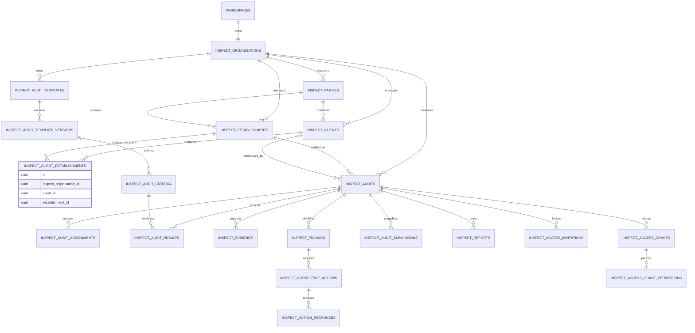

# FKT Inspect — modelo relacional lógico e integridade

## Estado

**Desenho lógico para revisão técnica.** Este documento traduz a arquitectura funcional e a matriz de permissões num modelo relacional candidato. Os nomes são propostos, não são nomes SQL aprovados. Não contém migração executável e não autoriza alterações à BD remota.

## 1. Princípios

1. Uma única instância Supabase FKT e a regra Core actual de workspace principal mantêm-se.
2. Uma Organização Inspect pertence a um workspace FKT. A relação proposta é 1:1, com `workspace_id` único e obrigatório.
3. Clientes, entidades operadoras e estabelecimentos são conceitos distintos.
4. A auditoria é a unidade de trabalho e de concessão externa no MVP.
5. Cada relação filha transporta as chaves de âmbito necessárias para constraints compostas; não confiar apenas em IDs isolados.
6. RLS deny-by-default complementa, mas não substitui, constraints e validações de domínio.
7. Dados internos e dados publicados externamente têm separação física.
8. Registos submetidos/publicados são versionados e não reescritos silenciosamente.

## 2. Modelo de entidades proposto

### 2.1. `inspect_organisations`

Uma organização que usa o módulo:
- `id uuid primary key`
- `workspace_id uuid not null unique references workspaces(id)`
- `organisation_type` — `consultancy`, `operator` ou `both`
- `display_name`
- `status`
- timestamps e actor de criação

A relação 1:1 é deliberada para não contornar o modelo Core. Não criar organizações Inspect por cliente nem workspaces por estabelecimento.

### 2.2. `inspect_parties`

Entidades legais/organizacionais envolvidas:
- `id`
- `inspect_organisation_id`
- designação e identificadores estritamente necessários;
- tipo de entidade e estado;
- timestamps.

Uma party pode assumir diferentes papéis na relação comercial e operacional. Evitar duplicar a mesma entidade quando cliente contratual e operador são a mesma pessoa colectiva/singular.

### 2.3. `inspect_clients`

Representa a relação de cliente contratual gerida pela organização Inspect:
- `id`
- `inspect_organisation_id`
- `party_id` (parte contratante)
- referência/estado da relação comercial;
- timestamps.

A party do cliente pertence à mesma Organização Inspect por constraint composta. A tabela não concede acesso externo.

### 2.4. `inspect_establishments`

Representa o local físico:
- `id`
- `inspect_organisation_id`
- `operator_party_id nullable` (entidade que opera o estabelecimento); quando desconhecida na criação, registar a pendência e impedir que a auditoria a apresente como identificada
- nome, morada, actividade e estado;
- timestamps.

Para uma consultora, o estabelecimento pertence à sua carteira e identifica o operador. Para uma empresa que audita internamente, a party operadora pertence à própria organização Inspect e não é necessário inventar um cliente contratual.

A carteira de cada cliente exige a relação `inspect_client_establishments`:
- `id`, `inspect_organisation_id`, `client_id`, `establishment_id`;
- estado e datas de vigência da relação;
- referência contratual opcional e timestamps;
- unicidade por cliente/estabelecimento/organização e FKs compostas.

A relação é N:M: um cliente pode abranger vários estabelecimentos e um estabelecimento pode estar associado a mais do que um cliente contratual ao longo da carteira. A auditoria continua a identificar o cliente contratual concreto.

### 2.5. `inspect_audit_templates`, `inspect_audit_template_versions`, `inspect_audit_sections`, `inspect_audit_criteria`

Modelo de auditoria versionado:
- template pertence à organização;
- versão é imutável depois de publicada;
- secções e critérios pertencem a uma versão concreta;
- cada critério guarda código estável, texto, instrução, tipo de resposta, aplicabilidade e referência normativa versionada;
- uma versão publicada não é alterada; uma alteração cria versão nova.
- versões devem ter chave única composta `(id, inspect_organisation_id)`; critérios devem ter chave única composta `(id, template_version_id, inspect_organisation_id)`.

Critérios normativos não devem guardar apenas um URL genérico. Preservar diploma/fonte, artigo/ponto, versão/data de consulta e nota de aplicabilidade.

### 2.6. `inspect_audits`

Unidade de auditoria:
- `id`
- `inspect_organisation_id`
- `establishment_id`
- `contract_client_id nullable`
- `operator_party_id nullable` (snapshot da entidade operadora à data da auditoria)
- `operator_identity_pending_reason nullable` (obrigatório quando o operador não está identificado)
- `template_version_id`
- âmbito, datas, estado, auditor responsável;
- `submitted_at`, `closed_at`, versão/submissão;
- timestamps.

Constraints compostas garantem que estabelecimento, cliente contratual e versão de modelo pertencem à mesma organização. Quando `contract_client_id` não é nulo, a combinação cliente/estabelecimento tem de existir em `inspect_client_establishments`. A FK da versão usa `(template_version_id, inspect_organisation_id)`. O operador é copiado para a auditoria como snapshot histórico, para que alterações posteriores no estabelecimento não reescrevam quem foi identificado como operador na data auditada. `contract_client_id` pode ser nulo em auditorias internas do operador.

### 2.7. Atribuições de auditoria

`inspect_audit_assignments`:
- `id`, `inspect_organisation_id`, `audit_id`, `user_id`;
- `assignment_role` controlado: `auditor`, `reviewer` ou `observer`;
- actor que atribuiu, início/fim de vigência, estado e timestamps;
- unicidade por auditoria/utilizador, com histórico append-only para alterações/revogação.

Regras:
- owner/admin gere atribuições;
- `auditor` executa a auditoria atribuída e regista resultados/evidências/findings;
- `reviewer` revê a execução, pode devolver para correcção e autorizar submissão/publicação;
- `observer` tem leitura interna da auditoria atribuída;
- a separação auditor/reviewer é suportada, mas não obrigatória em todas as organizações no MVP;
- o papel `editor` do workspace, por si só, não concede acesso a todas as auditorias.

A autorização interna de trabalho deve validar simultaneamente membership Core activa, papel permitido e atribuição activa à auditoria. Não confiar apenas em `user_id` guardado no registo.

### 2.8. Resultados e medições

- `inspect_audit_results`: uma linha por critério da versão aplicada, estado, observação partilhável/factual, autor e timestamps. Cada resultado deve incluir `template_version_id` e usar FKs compostas para provar que a auditoria e o critério pertencem à mesma versão e organização.
- `inspect_audit_measurements`: valor, unidade, parâmetro, equipamento/local, instante de recolha, autor, limite/regra aplicável e referência/versão da regra.

As notas internas do auditor ficam em `inspect_audit_internal_notes`, separadas das tabelas de resultados partilháveis. Não confiar em RLS para esconder colunas.

### 2.9. Evidências

- `inspect_evidence`: metadados do objecto privado, organização, auditoria, autor, hash, MIME, tamanho, estado e retenção. Não usar `resource_type + resource_id` como única ligação relacional.
- `inspect_evidence_links`: associação interna tipada a resultado, finding, resposta ou relatório, através de FKs reais e constraints compostas; alternativa: tabelas de ligação separadas por tipo. Não aceitar IDs polimórficos sem FK.
- A publicação externa da evidência é feita por `inspect_publication_evidence`, ligada a uma publicação concreta; não criar uma segunda tabela de publicação de evidências com ciclo de vida concorrente.

O caminho Storage não contém PII nem nomes de clientes. Constraint composta liga evidência e recurso à mesma auditoria/organização. A autorização de download é verificada por pedido.

### 2.10. Não conformidades e acções

- `inspect_findings`: auditoria, resultado de origem, descrição factual, classificação/metodologia, estado, prazo e responsável.
- `inspect_corrective_actions`: finding, descrição, responsável interno/externo, prazo e estado.
- `inspect_action_responses`: submissão externa separada, autor autenticado, texto, instante do servidor e estado de revisão.
- `inspect_action_response_evidence`: liga evidência submetida à resposta concreta.
- `inspect_action_verifications`: registos internos append-only de verificação de implementação/eficácia.

O utilizador externo não altera o finding nem a acção original; cria uma resposta. Só auditor autorizado pode verificar eficácia ou fechar.

### 2.11. Relatórios e publicações

- `inspect_audit_submissions`: snapshot imutável da submissão, número/versão, actor, instante, hash do payload.
- `inspect_reports`: ficheiro emitido, versão do template, hash, emissor, instante e estado.
- `inspect_publications`: publicação externa de uma submissão concreta, com `audit_id`, `submission_id`, número, actor, instante e eventual revogação. Não usar `resource_type/resource_id`.
- `inspect_publication_evidence`: associação entre publicação e evidência que pode ser descarregada nessa publicação; FKs compostas garantem a mesma organização e auditoria.

O relatório final é um artefacto imutável. Correcções geram adenda ou nova emissão ligada à anterior.

### 2.12. Convites e concessões

Separar convite pendente de concessão activa:

- `inspect_access_invitations`: organização, auditoria, email normalizado, token_hash, validade, estado, autor, consumo; sem `user_id` fornecido pelo browser.
- `inspect_access_grants`: organização, auditoria, destinatário `user_id`, estado, criado/aceite/revogado/expirado, autor e motivo.
- `inspect_access_grant_permissions`: concessão e permissão enum/controlada.
- `inspect_access_events`: eventos append-only de envio, reenvio, aceitação, alteração de permissões, expiração e revogação.

Aceitação através de RPC/Edge Function autenticada: confirmar no servidor o estado de verificação do email da conta (não presumir que existe um claim `email_verified` no JWT), comparar o email normalizado com o destinatário, validar token válido e não consumido; consumir atomicamente; derivar `auth.uid()`; criar concessão. Não aceitar `user_id` do cliente como autoridade.

A concessão é por auditoria concreta. Uma associação a cliente/contacto nunca é suficiente para autorizar acesso.

## 3. Diagrama de relações

O diagrama é conceptual. As cardinalidades opcionais e constraints finais devem ser confirmadas no SQL.

## 4. Constraints e integridade

### 4.1. Escopo composto

Usar unique constraints e foreign keys compostas, por exemplo:
- `inspect_clients (id, inspect_organisation_id)`;
- `inspect_establishments (id, inspect_organisation_id)`;
- `inspect_client_establishments (client_id, establishment_id, inspect_organisation_id)` e chave única equivalente;
- `inspect_audits (id, inspect_organisation_id)`;
- `inspect_audits (establishment_id, inspect_organisation_id)` referencia estabelecimento no mesmo âmbito;
- `inspect_audits (contract_client_id, establishment_id, inspect_organisation_id)` referencia a relação cliente/estabelecimento no mesmo âmbito quando o cliente contratual não é nulo;
- `inspect_audits (operator_party_id, inspect_organisation_id)` referencia a party operadora snapshot no mesmo âmbito;
- atribuições, resultados, evidências, findings, acções, relatórios, grants e publicações carregam `inspect_organisation_id` e referenciam a auditoria no mesmo âmbito.

Usar `ON DELETE RESTRICT` para dados históricos e relações referenciadas; evitar cascatas destrutivas sobre auditorias submetidas, relatórios, evidências e eventos.

### 4.2. Unicidade e cardinalidade

- `inspect_organisations.workspace_id UNIQUE NOT NULL`.
- Uma organização por workspace.
- Um resultado por (audit_id, criterion_id).
- Uma submissão por (audit_id, submission_number).
- Um convite activo por auditoria/email, com política de reenvio que invalida o token anterior.
- Grants sem duplicados activos para (audit_id, user_id).
- Permissões limitadas a enumeração controlada e únicas por grant.
- Hash de token único; token em claro nunca persistido.

### 4.3. Integridade de estado

- Resultado `not_applicable` exige justificação.
- Resultado `not_verified` exige motivo.
- Auditoria submetida exige snapshot consistente e timestamp.
- Relatório emitido referencia submissão concreta.
- Resposta externa só pode referir acção atribuída ao grant e auditoria correspondente.
- Acção fechada não aceita novas respostas, salvo reabertura interna explícita e auditada.
- Evidência publicada tem de pertencer à auditoria e versão correctas.

Constraints simples devem ser CHECK/FK/UNIQUE; regras transversais complexas são validadas por RPC/transacção e testes.

## 5. RLS — desenho por grupos de tabelas

A política exacta deve ser detalhada numa matriz SQL antes da migração. Direcção obrigatória:

| Grupo | Equipa interna | Utilizador externo |
|---|---|---|
| Organização/clientes/estabelecimentos | Conforme workspace e papel Inspect | Sem leitura geral |
| Templates e versões | Gestão conforme papel | Sem acesso |
| Auditorias em rascunho/em execução | Equipa atribuída | Sem acesso |
| Resultados e medições internas | Auditor/equipa autorizada | Sem leitura de rascunho |
| Resultados publicados | Equipa autorizada | Só através da publicação/grant |
| Notas internas | Equipa autorizada | Nunca |
| Evidências privadas não publicadas | Equipa autorizada | Nunca |
| Evidências publicadas | Equipa autorizada | Só grant + publicação + permissão |
| Findings/acções | Equipa autorizada | Apenas versão publicada/atribuída |
| Respostas externas | Leitura e revisão interna | Inserção limitada na acção atribuída; sem update/delete |
| Verificações de eficácia | Auditor autorizado | Nunca |
| Relatórios | Equipa autorizada | Apenas relatório emitido e publicado |
| Convites/grants | Administradores autorizados | Apenas aceitação/consulta mínima do próprio convite; sem enumeração |
| Eventos de segurança | Administradores autorizados | Sem acesso geral |

Não expor tabelas internas directamente a utilizadores externos se a projecção de dados partilhados não estiver garantida. Preferir funções RPC/views com grants SQL mínimos e RLS nas tabelas subjacentes.

## 6. Storage

- Bucket dedicado privado para Inspect.
- Prefixos gerados pelo servidor e opacos; o caminho não confere autorização.
- Metadados de evidência ligam objecto, auditoria, organização e visibilidade.
- Upload externo apenas para resposta de acção atribuída.
- Validar MIME real, tamanho, extensão, hash e quota.
- Preferir download autenticado com RLS por objecto; se URL assinada for inevitável, usar TTL mínimo operacional e documentar a janela de validade.
- Para cada download, validar novamente concessão e publicação.
- Não prometer revogação instantânea de URL já emitida; avaliar proxy autenticado se o risco justificar.

## 7. Histórico e imutabilidade

Eventos append-only para:
- concessões, convites, permissões e revogações;
- submissão, publicação e despublicação;
- emissão/substituição de relatório;
- respostas externas e anexos;
- decisões do auditor sobre acções e eficácia.

Rascunhos podem ser editáveis por utilizadores internos autorizados, com histórico. Submissões, versões de modelos e relatórios emitidos não são alterados no local.

## 8. Testes pgTAP/CI obrigatórios

Criar fixtures para duas consultoras A/B; dois clientes A1/A2 em A; operadores distintos; dois estabelecimentos; auditorias partilhadas e não partilhadas; utilizadores externos com concessões diferentes; conta externa sem workspace e com workspace próprio.

Cobrir:
1. leitura interna dentro da organização correcta;
2. isolamento A/B;
3. isolamento A1/A2;
4. utilizador externo só lê a auditoria concedida e conteúdos publicados;
5. grant a uma auditoria não dá acesso a outra auditoria do mesmo cliente;
6. convite pendente/expirado/consumido/revogado não autoriza;
7. email não confirmado no servidor ou divergente não aceita convite;
8. grant sem `view_published_evidence` não descarrega evidência;
9. `respond_assigned_actions` não permite alterar finding, acção, resultado ou eficácia;
10. upload apenas na acção atribuída e com MIME/tamanho válidos;
11. IDs trocados em RPC, filtros e caminhos Storage não contornam autorização;
12. revogação bloqueia novos downloads/uploads; URL previamente emitida respeita o TTL documentado;
13. constraints rejeitam ligações cruzadas entre organizações;
14. submissões/relatórios/modelos publicados são imutáveis;
15. utilizador externo não consegue enumerar tabelas internas, clientes ou membros da organização.

Testar com roles reais (`anon`, `authenticated`) e claims reais de sessão nos testes locais. Não usar apenas chamadas com `service_role`, porque isso contorna RLS.

## 9. Pontos de revisão antes da migração

- Confirmar nomes e tipos reais de PK/FK no Core e workspace.
- Rever políticas existentes e evitar conflito com helpers/policies actuais.
- Decidir se notas internas e resultados partilháveis exigem tabelas separadas ou snapshot publicado; preferência por tabelas separadas para conteúdo confidencial.
- Confirmar comportamento de convite/entrega de email e recuperação de conta.
- Confirmar política legal de retenção e eliminação.
- Não assumir TTL fixo para URLs assinadas; preferir download autenticado com autorização revalidada em cada pedido. Se URL bearer for inevitável, definir o TTL mínimo compatível com o uso móvel e documentar que a revogação não é imediata.
- Rever cardinalidade da relação cliente contratual/estabelecimento para contratos que abrangem múltiplos locais.

## 10. Limites e validação efectuada

Este documento é um modelo lógico-relacional proposto, não migração SQL. Foi feita revisão estática do repositório e consulta read-only ao catálogo da única BD remota. Confirmou-se que não existem tabelas/bucket Inspect e que a constraint actual de módulos não permite ainda `inspect`. Foram também verificadas as políticas e constraints actuais de `workspaces` e `workspace_members`.

Não foram executados testes RLS Inspect, porque o módulo ainda não tem tabelas nem políticas. Os testes CI actualmente verdes cobrem o estado existente do Core, não o Inspect. A implementação deve começar localmente, com pgTAP/CI, após fechar o modelo físico. A BD remota única não deve ser alterada sem autorização específica.

## 11. Compatibilidade com a cardinalidade actual de memberships do Core

A revisão das migrações confirmou:
- `workspaces_user_id_unique` limita a um workspace próprio por utilizador;
- `workspace_members` tem unicidade por par `(workspace_id, user_id)`;
- não foi encontrada unicidade global de `user_id` em `workspace_members`;
- `useModuloActivo.ts` consulta a membership por utilizador com `.maybeSingle()`, assumindo no máximo uma.

O esquema permite tecnicamente memberships em vários workspaces, mas o hook actual não resolve essa cardinalidade. A discrepância está registada na issue #173 e não deve ser resolvida implicitamente no âmbito do Inspect.

Consequências para este modelo:
- utilizadores externos Inspect nunca são adicionados a `workspace_members` da organização consultora;
- o contexto «Partilhado comigo» não depende de `useModuloActivo` nem muda o workspace activo;
- os membros internos da organização Inspect continuam sujeitos ao modelo Core; a política de memberships múltiplas tem de ser decidida na issue #173;
- não criar constraints únicas globais nem alterar a resolução de workspace sem auditoria dos dados e decisão transversal ao Core.

## 12. Integridade entre versão do modelo e resultados

A revisão identificou uma constraint composta ainda necessária no desenho:
- `inspect_audit_template_versions` deve ter chave única composta por `(id, inspect_organisation_id)`;
- `inspect_audits` deve referenciar essa versão com `(template_version_id, inspect_organisation_id)`;
- `inspect_audit_criteria` deve ter chave única composta por `(id, template_version_id, inspect_organisation_id)`;
- `inspect_audit_results` deve referenciar a auditoria e o critério com o mesmo `template_version_id` e `inspect_organisation_id`.

Isto impede que um resultado de auditoria use, por erro ou manipulação, um critério de outra versão de checklist ou de outra organização. A constraint final deve ser validada com o ERD e os nomes SQL definitivos antes da migração.

## 13. Verificação de email em convites

Não assumir a existência de um claim JWT chamado `email_verified`. A aceitação deve ser autenticada e a verificação do estado do email deve ser feita no servidor através da identidade validada pelo Supabase Auth, confirmando o campo `email_confirmed_at` do utilizador autenticado e comparando o endereço normalizado com o destinatário do convite. O token é consumido atomicamente e o actor é derivado da sessão; o browser não escolhe o `user_id`.

## 14. Evitar relações polimórficas sem integridade referencial

A revisão identificou que expressões genéricas como `resource_type + resource_id` não criam uma FK real para cada tipo de recurso. Não devem ser a única forma de ligar evidências, publicações ou eventos a entidades.

Preferência:
- evidências ligadas por tabela de associação tipada, com FKs para os recursos suportados e CHECK que exige exactamente uma relação válida; ou
- tabelas de associação separadas por tipo de recurso.

Aplicar o mesmo princípio a publicações: evitar `resource_type/resource_id` sem FK. Resultados publicados devem estar ligados a uma submissão/snapshot concreta; relatórios a uma submissão; evidências a uma publicação de evidência; respostas a uma acção concreta.

Constraints compostas devem preservar simultaneamente `inspect_organisation_id`, `audit_id` e, quando aplicável, `template_version_id`. O modelo físico não pode depender apenas da validação na aplicação.

## 15. Ciclo de submissão e publicação externa — decisão de desenho

Para evitar duas fontes de verdade e impedir que uma alteração posterior no rascunho mude o que o cliente já viu:

1. A submissão cria um snapshot imutável, identificado por auditoria, número, instante, actor e hash.
2. O snapshot contém apenas campos destinados ao relatório/partilha. Notas internas, comentários privados e dados de gestão não entram no payload.
3. O relatório PDF é sempre gerado a partir desse snapshot e guarda FK para a submissão concreta; nunca é reconstruído a partir do estado vivo da auditoria.
4. A publicação externa referencia uma submissão concreta. A publicação pode ser revogada sem apagar a submissão nem o relatório.
5. Evidências externas são explicitamente associadas à publicação através de `inspect_publication_evidence`. A existência de um objecto no bucket ou de uma ligação interna não o torna público.
6. Respostas externas são novos registos associados a acções atribuídas; não alteram o snapshot original nem a constatação do auditor.
7. Uma correcção cria nova submissão/adenda e, se necessário, nova publicação. A versão anterior mantém-se auditável.

A tabela `inspect_publications` não deve conter um par polimórfico `resource_type/resource_id`. O modelo físico deve usar FKs reais para `inspect_audits` e `inspect_audit_submissions`; a associação de ficheiros usa a tabela tipada `inspect_publication_evidence`.

Esta decisão substitui qualquer interpretação anterior de publicação genérica por recurso. Não criar simultaneamente `inspect_evidence_publications` e `inspect_publication_evidence`.

## 16. Relação cliente–estabelecimento e snapshot do operador

A gestão de carteira exige uma associação explícita entre clientes e estabelecimentos, mesmo antes de existir uma auditoria. Por isso, `inspect_client_establishments` faz parte do modelo MVP e não é uma extensão futura.

A associação é N:M e tem vigência/estado. Para o mesmo par cliente/estabelecimento não são permitidos períodos de vigência sobrepostos; intervalos usam semântica semiaberta `[valid_from, valid_until)` para permitir transição sem ambiguidade. Se o negócio exigir contratos simultâneos distintos para o mesmo par, deve existir entidade `inspect_contracts` própria antes de permitir duplicação. A auditoria referencia a associação concreta e guarda snapshot do identificador/referência contratual e do intervalo vigente à data da auditoria, através de FK composta; não basta validar cada ID isoladamente. A consulta read-only ao catálogo remoto confirmou que `btree_gist` não está actualmente instalada (estão instaladas `pgcrypto`, `uuid-ossp` e `pg_stat_statements`). A opção preferida é uma exclusion constraint GiST sobre `(inspect_organisation_id, client_id, establishment_id, tstzrange(valid_from, valid_until, '[)'))`, instalando `btree_gist` numa migração local dedicada e validando a compatibilidade com Supabase/CI. Se a extensão não puder ser usada, a alternativa é trigger transaccional com lock advisory por par organização/cliente/estabelecimento e teste concorrente explícito. Nunca deixar esta regra apenas na aplicação.

O operador alimentar é uma entidade distinta do cliente contratual. O estabelecimento guarda o operador actualmente identificado, mas cada auditoria conserva um snapshot de `operator_party_id` (ou uma pendência justificada) no momento da sua criação/submissão. Uma alteração posterior do operador não modifica auditorias históricas.

Não inferir o operador a partir do cliente contratual. Se for desconhecido, guardar a pendência e tornar explícita essa limitação no relatório.

## 17. Atribuição e separação de funções

A autorização interna de auditoria não pode depender apenas do papel geral do workspace. Cada auditoria tem atribuições explícitas (`auditor`, `reviewer`, `observer`) ligadas ao utilizador e à organização. A policy deve confirmar membership activa no workspace, papel Core compatível e atribuição activa.

O modelo suporta revisão por pessoa diferente do auditor, mas não impõe essa separação como requisito universal do MVP. A organização pode configurar a revisão conforme a sua dimensão e procedimento. Owner/admin conserva poderes de gestão, sem contornar as transições nem o histórico.

Separar o estado operacional da trilha histórica:
- `inspect_audit_assignments` representa a atribuição actual, com `valid_from`, `valid_until`, `status`, actor de concessão e actor/motivo de revogação;
- `inspect_audit_assignment_events` é append-only e regista criação, alteração de função, suspensão, reactivação e revogação, com actor, instante, motivo e snapshot dos valores relevantes;
- a alteração/revogação da atribuição e a inserção do evento ocorrem na mesma transacção;
- uma atribuição revogada ou fora da vigência bloqueia imediatamente novas operações, sem apagar autoria histórica.

Não declarar a própria linha de atribuição simultaneamente append-only e mutável. O evento é imutável; o registo operacional mantém o estado actual.

## 18. Máquina de estados da auditoria e submissão

Estados operacionais propostos:
- `draft`: criada, ainda não iniciada;
- `in_progress`: execução em curso;
- `in_review`: enviada para revisão, sem edição pelo auditor até devolução;
- `changes_requested`: devolvida pelo reviewer, com motivo;
- `approved`: revisão aprovada, pronta para submissão;
- `submitted`: snapshot imutável criado;
- `closed`: acompanhamento encerrado;
- `cancelled`: cancelada com motivo e actor.

Transições permitidas:
- `draft -> in_progress`: auditor atribuído;
- `in_progress -> in_review`: auditor atribuído, sem gravações pendentes;
- `in_review -> changes_requested`: reviewer atribuído, com motivo obrigatório;
- `changes_requested -> in_review`: auditor atribuído, após alterações;
- `in_review -> approved`: reviewer atribuído;
- `approved -> submitted`: operação de submissão transaccional, com snapshot/hash e número sequencial;
- `submitted -> closed`: actor interno autorizado, após conclusão do acompanhamento;
- estados não finais -> `cancelled`: owner/admin ou reviewer autorizado, com motivo e evento.

A submissão cria o snapshot na mesma transacção que altera o estado. Não permitir edição do conteúdo-base depois de `submitted`; alterações posteriores são adenda/submissão nova. A publicação externa é um acto separado de `submitted`, exige permissão específica e referencia a submissão concreta. A publicação pode ser revogada sem reabrir nem alterar a submissão.

Para organizações sem pessoa revisora distinta, permitir configuração explícita de auto-revisão pelo owner/auditor principal, com evento que identifica a excepção. Não presumir que toda a consultora tem equipa suficiente para segregação de funções.

Testar todas as transições válidas e inválidas, concorrência de submissão, duplicação de números, tentativas de alteração após submissão e publicação de snapshot diferente do relatório.

## 19. Extensão candidata — gestão operacional HACCP (28/11/2026)

A arquitectura operacional completa está descrita em fkt-inspect-haccp-operational-architecture.md. O modelo relacional anterior cobre sobretudo carteira, auditorias e partilha; **não é suficiente, por si só, para um produto HACCP operacional**. As entidades seguintes são candidatas para revisão em #175, não SQL aprovado.

### Plano e conhecimento HACCP
- inspect_food_safety_plans: plano por organização/estabelecimento e estado.
- inspect_food_safety_plan_versions: versão, snapshot, aprovação, autor e vigência.
- inspect_processes, inspect_process_steps: processos e etapas reais do estabelecimento.
- inspect_hazards: perigo identificado, categoria, etapa, fundamento e estado de validação.
- inspect_control_measures: medida, classificação atribuída no plano, justificação e responsável.
- inspect_control_parameters: parâmetro, valor/intervalo, unidade, tipo de limite, fonte, âmbito e versão.
- inspect_haccp_documents: procedimentos, instruções e documentos ligados à versão do plano.

### Operação
- inspect_areas, inspect_equipment: locais e equipamentos do estabelecimento.
- inspect_monitoring_plans, inspect_monitoring_assignments: controlos configurados e atribuições.
- inspect_monitoring_records, inspect_monitoring_record_events: execução e histórico append-only.
- inspect_cleaning_plans, inspect_cleaning_tasks, inspect_cleaning_records: plano, tarefas e execução de higienização.
- inspect_suppliers, inspect_food_products: fornecedores e produtos alimentares.
- inspect_receipts, inspect_receipt_items: recepção e itens recebidos.
- inspect_lots, inspect_lot_events: lotes e eventos de rastreabilidade.
- inspect_product_life_records: abertura/preparação, data de utilização definida pelo procedimento, responsável e estado.
- inspect_oil_control_records: registos de óleo, apenas se confirmados no âmbito do piloto.

### Integridade e histórico
- Cada registo operacional pertence a uma organização e estabelecimento e, quando aplicável, referencia o plano/versão e controlo que o originou.
- O registo concreto preserva snapshot do parâmetro/regra/unidade aplicados no momento; alterações posteriores ao plano não alteram medições históricas.
- Eventos de execução, correcção, validação, lote e acção são append-only ou versionados.
- A origem de uma não conformidade deve ser tipada com FK real. Não usar source_type + source_id sem integridade referencial; usar tabelas de ligação tipadas ou FKs opcionais mutuamente exclusivas com CHECK.
- Consultores não recebem acesso operacional por pertencerem à carteira: é necessária concessão explícita, com âmbito e permissões definidos.
- Não codificar temperaturas, frequências, prazos de validade ou classificações universais.

### Relação com auditorias
Auditorias continuam como processo distinto. Podem referenciar uma versão do plano e amostras/registos operacionais, mas não devem duplicar a fonte operacional nem substituir o registo diário.

A lista é um ponto de partida. Cardinalidades, campos, chaves compostas, políticas RLS, GRANT e retenção têm de ser revistos em #175 e validados com o esquema Core antes do DDL.
