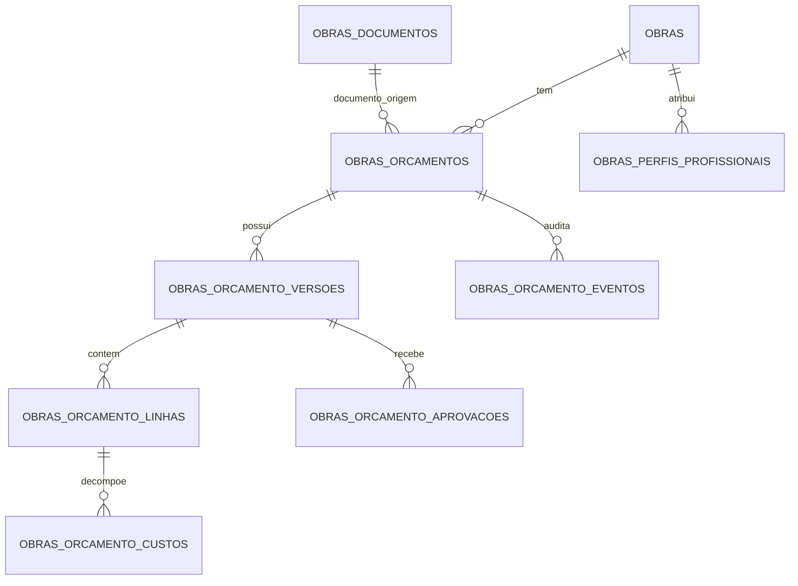

# FKT Works — Modelo de dados da orçamentação

**Estado:** desenho lógico proposto; não implementado.
**Data:** 28-11-2026
**Base de referência:** esquema real da única BD `gllrqrqonwuacjxbtgnp`, migrações da `main` e auditoria em `fkt-works-budgeting-schema-audit.md`.
**Importante:** este documento não é uma migração SQL e não autoriza alterações à BD.

## 1. Princípios

- Uma obra pode ter vários orçamentos e cada orçamento pode ter várias versões.
- Empreiteiro e Fiscal usam o mesmo núcleo de dados; o perfil profissional é atribuído por obra e não substitui os papéis de segurança do workspace.
- O orçamento simples não exige decomposição de custos.
- A versão aprovada é preservada. Uma alteração material cria nova versão e exige nova aprovação; o fluxo tem de ser curto.
- Custos internos são informação separada e não são visíveis ao perfil Fiscal por defeito.
- Ficheiros originais e comprovativos usam o arquivo documental existente.
- Todas as entidades operacionais ficam ligadas a `workspace_id` e `obra_id`, com integridade composta e RLS.
- Os cálculos são feitos no servidor com decimal exacto; o cliente não é fonte de verdade para totais, autoria, estado ou permissões.

## 2. Relações

As relações são lógicas. Os nomes finais e as chaves concretas serão validados no desenho SQL.

## 3. Entidades propostas

### 3.1 `obras_orcamentos` — identidade estável do orçamento

Um registo por orçamento, independentemente das versões.

Campos principais:
- `id`, `workspace_id`, `obra_id`;
- `codigo`, `titulo`, `tipo`: inicial, revisão, alternativo, trabalhos adicionais, trabalhos a menos;
- `origem`: manual ou importação;
- `documento_origem_id` opcional, ligado a `obras_documentos`;
- `entidade_proponente` e identificação descritiva da contraparte, quando aplicável;
- `current_version_id` e `approved_version_id`;
- `created_by`, `created_at`, `updated_at`.

Restrições:
- FK composta para `obras(id, workspace_id)`.
- Unicidade de `(id, workspace_id, obra_id)` para permitir FKs compostas das tabelas filhas.
- Não guardar aqui valores que pertencem a uma versão.

### 3.2 `obras_orcamento_versoes` — fotografia imutável do conteúdo

Cada versão contém o cabeçalho comercial e os totais daquela revisão.

Campos principais:
- `id`, `orcamento_id`, `workspace_id`, `obra_id`, `numero_versao`;
- `versao_anterior_id` opcional;
- `estado`: rascunho, submetido, pendente_aprovacao, aprovado, rejeitado, substituido;
- `modo_preco`: com_iva ou sem_iva;
- `taxa_iva_predefinida` e referência opcional à configuração de taxas;
- `validade`, `prazo` e condições comerciais, se aplicáveis;
- `moeda` (código ISO 4217; proposta inicial EUR, a confirmar);
- totais calculados: base tributável, IVA e total;
- `created_by`, `created_at`, `submitted_at`.

Regras:
- Depois de submetida, a versão não é editada directamente.
- Alteração material gera nova versão derivada da anterior.
- `approved_version_id` no orçamento continua a apontar para a última versão aprovada enquanto a versão seguinte aguarda decisão.
- A versão anterior aprovada mantém-se consultável e comparável.
- Alterações não materiais são registadas e não devem criar um pedido de aprovação desnecessário. A forma exacta de as representar (evento de auditoria ou nova versão não material) será fechada no contrato da RPC.

### 3.3 `obras_orcamento_linhas` — artigos/itens comerciais

Uma linha pertence sempre a uma versão, nunca directamente ao orçamento.

Campos principais:
- `id`, `orcamento_versao_id`, `workspace_id`, `obra_id`;
- `ordem`, `referencia` opcional, `descricao`, `rubrica` opcional;
- `tipo_linha`: quantidade ou verba_global;
- `quantidade` e `unidade` (obrigatórios para quantidade);
- `preco_unitario` (obrigatório para quantidade);
- `valor_global` (obrigatório para verba_global);
- desconto opcional: `desconto_tipo` percentual ou valor; `desconto_valor`;
- modo de preço e taxa de IVA opcionais para substituir as predefinições da versão;
- snapshots calculados: valor antes do desconto, desconto, base tributável, taxa, IVA e total.

Checks de integridade:
- Linha quantidade: quantidade positiva, unidade e preço unitário presentes; `valor_global` nulo.
- Linha verba global: `valor_global` presente; quantidade, unidade e preço unitário nulos.
- Não permitir descontos superiores ao valor da linha.
- O servidor recalcula os valores e rejeita totais enviados pelo cliente que não correspondam às regras.

### 3.4 `obras_orcamento_custos` — decomposição interna opcional

Uma ou mais componentes ligadas a uma linha:
- `id`, `linha_id`, `workspace_id`, `obra_id`;
- `categoria`: materiais, mão_de_obra, equipamentos, outros;
- `descricao`, quantidade/unidade opcionais, custo unitário e custo total;
- ordem e autoria.

Não é necessária para criar uma linha simples. A soma dos componentes permite calcular custo interno estimado e margem, mas não altera automaticamente o preço proposto ao cliente.

**Segurança específica:** RLS mais restritiva. Só utilizadores com permissão de escrita no workspace e perfil profissional Empreiteiro na obra podem consultar/alterar custos internos. O perfil Fiscal não recebe acesso por defeito. A interface nunca deve incluir custos internos em PDFs ou exportações destinadas ao cliente/fiscal sem uma acção explícita e autorizada.

### 3.5 `obras_orcamento_aprovacoes` — decisões sobre versões

Regista pedidos e decisões sem reescrever aprovações anteriores.

Campos principais:
- `id`, `orcamento_id`, `versao_id`, `workspace_id`, `obra_id`;
- `estado`: pendente, aprovado, rejeitado, cancelado;
- `decidido_por`, nome/entidade declarada, `decidido_em`, observação;
- `documento_comprovativo_id` opcional, FK para `obras_documentos`;
- timestamps de criação/decisão.

Uma decisão é append-only: nova decisão não apaga uma decisão anterior. A aprovação registada no FKT é uma declaração do utilizador, não assinatura electrónica nem certificação jurídica.

### 3.6 `obras_orcamento_eventos` — auditoria detalhada append-only

Eventos tipados para o domínio orçamental:
- `id`, `orcamento_id`, `versao_id` opcional, `workspace_id`, `obra_id`;
- `tipo_evento`: criado, linha_adicionada, linha_alterada, linha_removida, submetido, aprovado, rejeitado, alteracao_material, alteracao_nao_material, importado, etc.;
- `actor_id`, `ocorrido_em`;
- `dados_anteriores` e `dados_novos` JSONB;
- resumo legível e identificadores das entidades afectadas.

Sem UPDATE/DELETE para utilizadores normais. Os eventos complementam `obras_historico_eventos`, não substituem o histórico transversal existente. O conteúdo deve excluir segredos, tokens e caminhos internos de Storage que não sejam necessários à auditoria.

### 3.7 `obras_perfis_profissionais` — perfil por obra

- `id`, `workspace_id`, `obra_id`, `user_id`;
- `perfil`: empreiteiro ou fiscal;
- actor e data de atribuição.

Unicidade proposta de `(obra_id, user_id)`, com alteração de perfil auditada. A mesma pessoa pode ter perfis diferentes em obras diferentes.

Este perfil é contextual e não concede acesso por si só. A autorização exige também pertença e papel válido no workspace, mais acesso à obra. A atribuição é feita por utilizador autorizado do workspace.

## 4. Taxas de IVA e valores

- A versão guarda modo de preço e taxa predefinida.
- A linha pode herdar esses valores ou substituí-los.
- Guardar snapshot numérico da taxa usada em cada linha e referência à configuração de taxa, quando existir.
- A tabela/configuração de taxas deve ser administrada centralmente, com país/região, código, taxa, vigência e estado. Não codificar taxas no frontend nem inferir taxas ausentes durante importação.
- Guardar base tributável, IVA e total com IVA em cada linha e totais por versão.
- Precisão decimal e arredondamento seguem a secção 7 de `fkt-works-budgeting-schema-audit.md`.
- Não está decidido se o MVP suporta moedas além de EUR; não converter moedas automaticamente.

## 5. Integridade, RLS e operações

- Todas as tabelas operacionais incluem `workspace_id` e `obra_id`.
- FKs compostas asseguram que orçamento, versão, linha, custo, aprovação e evento pertencem à mesma obra/workspace.
- Índices nas FKs e nas pesquisas usuais por obra, estado, número de versão e data.
- RLS em todas as tabelas públicas, alinhada com `private.obras_can_read(workspace_id)` e `private.obras_can_write(workspace_id)`.
- A tabela de custos internos tem política adicional por perfil profissional Empreiteiro.
- O perfil profissional não substitui `owner/admin/editor/viewer` nem contorna RLS.
- RPCs transaccionais para criar orçamento+primeira versão+linhas, submeter, aprovar/rejeitar e criar nova versão. Preferir SECURITY INVOKER; qualquer excepção exige justificação e revisão de segurança.
- Validar actor com `auth.uid()`; nunca aceitar actor, workspace, estado ou totais como verdade vindos do cliente.
- Triggers/RPCs impedem alteração ou eliminação de versões submetidas/aprovadas, linhas associadas, aprovações e eventos.
- O arquivo existente `obras_documentos` / `obras_documento_versoes` é reutilizado para ficheiros originais e comprovativos; não criar novo bucket nesta fase.

## 6. Fluxo de alteração e aprovação rápida

1. Abrir o orçamento e editar normalmente.
2. Guardar cria uma nova versão, preservando a aprovada.
3. O sistema compara automaticamente a versão anterior e a nova.
4. Se a alteração for não material, regista evento e não exige decisão da contraparte.
5. Se for material, a nova versão fica `pendente_aprovacao`; o orçamento continua a apontar para a última versão aprovada como referência.
6. O responsável abre uma ligação directa, vê um resumo curto (campos alterados, valores anterior/novo, diferença no total) e escolhe **Aprovar alterações** ou **Rejeitar alterações**.
7. A decisão fica registada sem apagar versões ou decisões anteriores.

O fluxo não deve exigir formulário longo nem navegação por várias páginas. A configuração do aprovador e a possibilidade de aprovação por utilizador externo ainda precisam de decisão funcional.

## 7. Pontos que impedem fechar a migração

1. **Colaboração externa:** a tabela `obras` pertence actualmente a um único `workspace_id`. O desenho acima cobre utilizadores membros desse workspace. Se o cliente/empreiteiro/fiscal de outra empresa tiver de entrar no FKT e aprovar directamente, é necessário decidir um modelo de partilha entre workspaces (não se resolve atribuindo apenas o perfil Fiscal).
2. **Moeda:** confirmar se o MVP é exclusivamente EUR ou se deve aceitar outras moedas desde o início.
3. **Aprovador:** definir quem pode aprovar (responsável designado na obra, owner/admin, ou membro com perfil Fiscal/Empreiteiro) e o fallback se não houver responsável.
4. **Taxas:** confirmar a origem e o responsável pela manutenção da configuração de taxas, incluindo jurisdição e vigência.

Não criar migração enquanto estes pontos não forem decididos e enquanto o desenho não tiver testes de RLS/isolamento e de cálculos.
